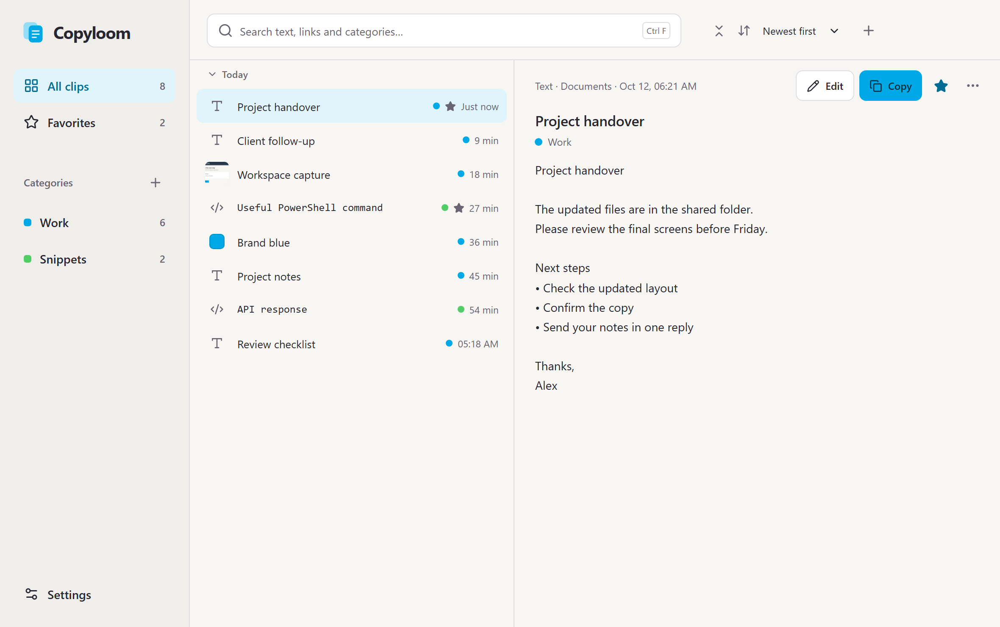
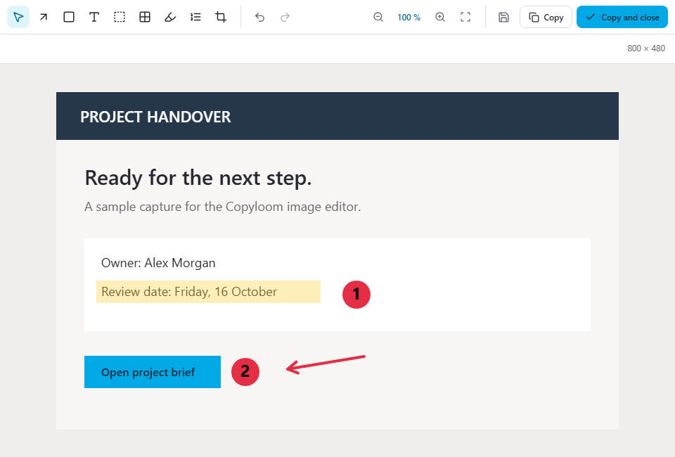
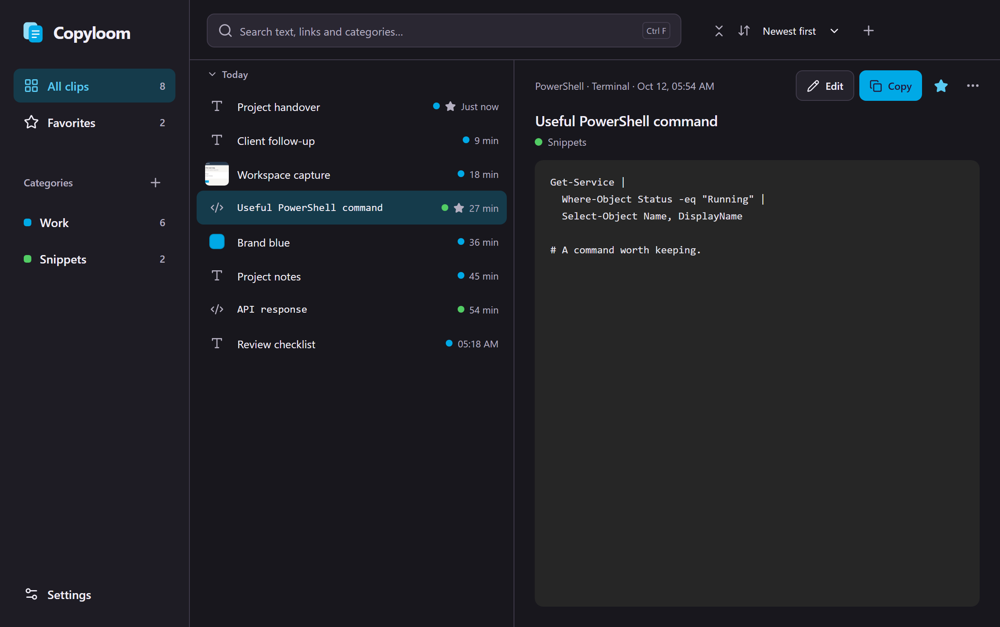

<p align="center"></p>

<h1 align="center">Copyloom</h1>

<p align="center">A clipboard history and image editor for Windows.</p>

<p align="center"></p>

Copyloom keeps what you copy: text, links, code and images. Press a shortcut where you are working, pick a clip from a small list, and it is pasted into the app you came from. The library window lets you search, sort and organise the whole history.

## Why not Win+V?

| | Win+V | Copyloom |
|---|---|---|
| History | 25 items, cleared on restart unless pinned | As long as you choose, from a day to forever |
| Search | No | Search as you type, tolerant of typos |
| Organising | Pin items | Favorites and categories |
| Images | Small thumbnails | Full images, preview and image editor |
| Text in images | No | Copy the text in a screenshot, recognised on your PC |
| Leave apps out | No | Exclude apps, such as a password manager |
| Storage | Windows | An encrypted database in a folder you choose, with backups and export |

Copyloom can also take over Win+V, and give it back to Windows again.

## Screenshots

| Image editor | Dark theme |
|---|---|
|  |  |

## Install

Copyloom runs on Windows 11, 64-bit. It is in testing; installers will be published under [Releases](../../releases). Until then, [build it from source](#build-from-source).

## Features

**Quick panel**
- Opens at the mouse pointer, the text cursor, the centre of the screen or where it was last.
- Search as you type, and filter by favorites or category.
- Move it by its header and resize it from the corner.
- Space previews the whole clip; a trash button removes one.

**Library**
- Clips grouped by day, with the selected clip shown in full beside the list.
- Favorites, categories, renaming and text editing.
- Copy several text clips together as one.

**Images**
- Capture an area of the screen with a shortcut of your choice, such as Print Screen.
- Edit with arrows, rectangles, text, highlighting, numbered steps, pixelation, redaction and cropping.
- Copy the text in an image with Windows' built-in text recognition.

**History and storage**
- Choose how long to keep clips; favorites stay until you remove them.
- Exclude apps, and pause collection at any time.
- The history is encrypted with your Windows account. Local backups, a movable data folder, and password-protected export and restore.

**Everyday use**
- Pastes straight into the app you came from, or only copies, as you prefer.
- Keeps formatting; Shift pastes plain text.
- Starts with Windows if you want. English and Swedish, light and dark.

## Keyboard shortcuts

**Anywhere**

| Shortcut | Action |
|---|---|
| `Ctrl+Shift+V` | Open or close the quick panel (configurable, or Win+V) |
| A key of your choice | Capture an area of the screen (off until you choose one) |

**Quick panel and library**

| Shortcut | Action |
|---|---|
| `↑` `↓` | Select the previous or next clip |
| `Enter` | Paste the selected clip |
| `Shift+Enter` | Paste as plain text |
| `Ctrl+1` … `Ctrl+9` | Paste one of the first nine clips |
| `Ctrl+F` | Search; in the quick panel you can also just start typing |
| `Space` | Preview the whole clip |
| `Delete` | Delete the selected clip |
| `Ctrl+Z` | Bring back what you deleted |
| `Shift+F10` | Open the clip's menu |
| `Esc` | Clear the search, then close the quick panel |

**Image editor**

| Shortcut | Action |
|---|---|
| `A` `R` `T` `H` | Arrow, rectangle, text, highlighter |
| `I` `O` `D` `C` | Numbered steps, pixelate, redact, crop |
| `Esc` | Back to the selection tool |
| `Ctrl+Z` / `Ctrl+Y` | Undo / redo |
| `Ctrl+S` or `Ctrl+Enter` | Copy and close |
| `Ctrl+Shift+C` | Copy and keep editing |
| `Ctrl+Shift+S` | Save as a file |

## Your data

Copyloom does not connect to the internet. Clips, images and settings stay on your PC, in an encrypted database. Text recognition uses Windows' own engine on your PC.

## Build from source

Requirements (Windows):
- Node.js 24;
- Rust with the MSVC toolchain;
- Visual Studio Build Tools with C++;
- Perl and NASM, for the OpenSSL that SQLCipher is built with.

```powershell
npm install
npm run desktop                                # run the app in development
npm test                                       # unit tests
npm run test:native                            # Rust tests
npx playwright test                            # interface tests (Microsoft Edge)
node scripts/tauri-local.mjs build --bundles nsis
```

The installer is written to `src-tauri/target/release/bundle/nsis/`. `npm run dev` shows the interface in a browser with sample data.

Built with [Tauri 2](https://tauri.app), Rust, React and TypeScript.

## Support

Copyloom is free, at home and at work. If it saves you time, you can support it on [Ko-fi](https://ko-fi.com/copyloom).

## License

Copyright © 2026 Copyloom. Licensed under the [GNU General Public License v3.0](LICENSE) or later.
